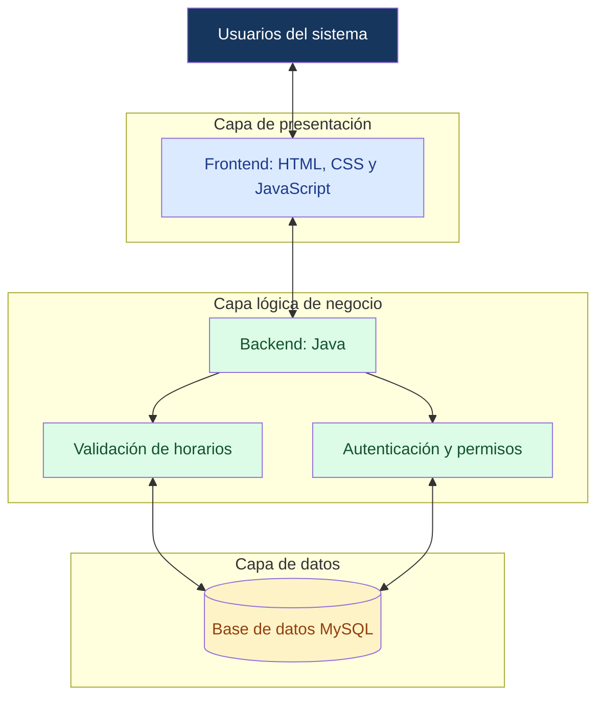
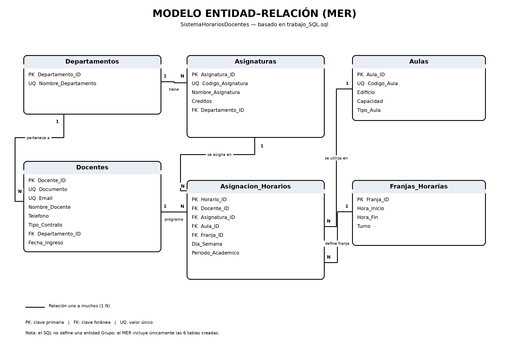

# Sistema de Horarios de Planta Docente

El Sistema de Gestión de Horarios de la Planta Docente es una solución tecnológica orientada a optimizar los procesos administrativos y académicos relacionados con la planificación y distribución de las actividades del personal docente. Su propósito principal es centralizar la información correspondiente a los profesores, las asignaturas, los grupos académicos y las jornadas facilitando su administración mediante una plataforma organizada y accesible.

La implementación de este sistema busca reducir la dependencia de metodologías convencionales y procedimientos manuales que pueden ocasionar inconsistencias en la información, duplicidad de asignaciones, cruces de horarios y dificultades para consultar o actualizar la planificación académica. Asimismo, pretende mejorar la disponibilidad de la información, agilizar las tareas administrativas y proporcionar una herramienta que contribuya a la toma de decisiones dentro de la institución educativa.

##  problema base

En una institución educativa se utiliza un método obsoleto para administrar los horarios de la planta docente, mediante metodologías convencionales y procesos no automatizados. Esto dificulta la distribución de las clases entre el personal docente y genera cruces de horarios, así como errores en la asignación de grupos y salones a cada docente. Esta situación ocasiona desorganización y pérdida de tiempo en la planificación académica de la institución educativa.

##  valor del sistema

El valor del Sistema de Gestión de Horarios de la Planta Docente radica en la optimización de los procesos administrativos y académicos mediante la centralización de la información, la automatización de tareas y la reducción de errores en la asignación de horarios. Su implementación permite mejorar la organización institucional, agilizar la consulta y actualización de datos, prevenir conflictos en la programación académica y facilitar la toma de decisiones, contribuyendo a una gestión más eficiente, precisa y confiable de los recursos humanos y físicos de la institución educativa.

##  Arquitectura del Sistema



## modelo de datos



## stack tecnologico

El proyecto está construido bajo las siguientes tecnologías y versiones:

*   **Entorno de Desarrollo:** Visual Studio Code (v1.144.0)
*   **Lenguaje Backend:** java 17
*   **Base de Datos:** MySQL (v8.0+)
*   **Cliente de Base de Datos:** MySQL Workbench / Extensión MySQL para VS Code
*   **Control de Versiones:** Git & GitHub

## guia de configuracion

Sigue estos pasos para desplegar y ejecutar el proyecto en tu entorno local.

### 📋 Pre-requisitos
Antes de comenzar, asegúrate de tener instalado lo siguiente:
*   [Git](https://github.com/josevieyraal-create/trabajo-sql.git) (para clonar el repositorio).
*   [Visual Studio Code](https://code.visualstudio.com/) con el **Extension Pack for Java** instalado.
*   [JDK (Java Development Kit) 17](https://www.oracle.com/java/technologies/downloads/#java17) o superior.
*   [MySQL Server y MySQL Workbench](https://dev.mysql.com/downloads/) (versión 8.0 o superior).

### 🚀 Pasos de Instalación

**1. Clonar el repositorio**
Abre una terminal (en VS Code o en tu sistema) y ejecuta:
```bash
git clone https://github.com/josevieyraal-create/trabajo-sql.git
cd trabajo-sql
```

## flujo de trabajo

Para garantizar un desarrollo ordenado y evitar conflictos en el código, el equipo utiliza la metodología **Git Flow simplificado**, gestionado a través de la extensión de Git integrada en Visual Studio Code y sincronizado con GitHub.


## licencias y creditos

### Equipo de Desarrollo

Este proyecto fue desarrollado de forma colaborativa por:

*   **Desarrollador 1 - Backend:** [Samuel Calle] (Lógica del servidor, API y endpoints del CRUD).
*   **Desarrollador 2 - Base de Datos:** [Jose Luis Vieyra] (Diseño del Modelo Entidad-Relación, creación de la base de datos MySQL y scripts SQL).
*   **Desarrollador 3 - [Tu Rol]:** [Emmanuel Berrio] (Ej: Documentación técnica, frontend, testing, integración).

### Licencia
Este proyecto está bajo la licencia **MIT**. 

Esto significa que el código es de uso libre para fines educativos y/o personales, siempre y cuando se otorgue el crédito correspondiente a los autores (el equipo de desarrollo mencionado arriba). 